<p align="center">
  
</p>

<p align="center">
  <a href="https://linkedin.com/in/noah-smo"></a>
  
</p>

```console
noah@rouen ~ % ls -l ~/projects --featured
```

<table>
  <tr>
    <td width="50%" valign="top">
      <h3>📁 <a href="https://github.com/NoahSmo/clawdio">clawdio/</a></h3>
      <p>Your Claude Code quota and agent status, right in the Mac notch — with Clawd, a pixel-art mascot that reacts to what Claude is doing.</p>
      <p><code>swift</code> <code>appkit</code> <code>swiftui</code> <code>macos 14+</code></p>

```sh
brew install --cask NoahSmo/clawdio/clawdio
```

</td>
    <td width="50%" valign="top">
      <h3>📁 <a href="https://github.com/NoahSmo/HiddenBar">HiddenBar/</a></h3>
      <p>A lightweight, native Swift app that hides the menu bar icons you don't want to see on macOS.</p>
      <p><code>swift</code> <code>macos</code> <code>menu bar</code></p>

```sh
brew install --cask noahsmo/tap/hiddenbar
```

</td>
  </tr>
</table>

```console
noah@rouen ~ % cat ~/.stack.yml
```

```yaml
languages:  [Python, JavaScript, Swift, C#]
frameworks: [Next.js, Node.js, .NET, SwiftUI]
databases:  [PostgreSQL, MongoDB, MySQL]
currently:  "AI with Python @ Wesur · macOS apps after hours"
```

```console
noah@rouen ~ % git log --author=NoahSmo --stat
```

<p>
  
  
</p>

```console
noah@rouen ~ % exit
[Process completed] — thanks for stopping by ✨
```
